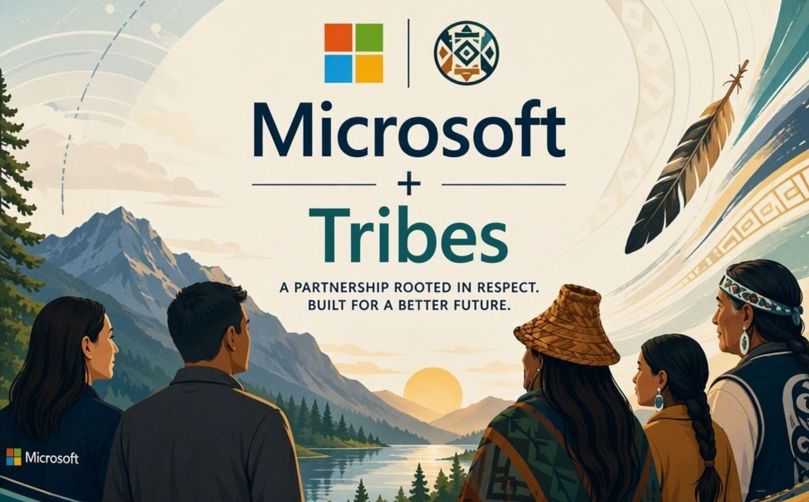

  

# MicrosoftTribalNations — Copilot Agent Gallery

A collection of Microsoft 365 Copilot agent instructions, packaged so they are easy to browse and paste into **Copilot Agent Builder**.

> 🌐 **Companion site:** [**Microsoft 365 Copilot Use Cases for Tribal Nations**](https://jolly-mud-07a6c1e0f.6.azurestaticapps.net/) — a browsable gallery of ready-to-use Copilot prompts and scenarios tailored for Tribal Nations. Use it to discover prompts; use this repo to deploy the agents.

Each agent lives in its own folder under [`agents/`](./agents) and includes:

- `README.md` — what the agent does and how to build it
- `instructions.txt` — the paste-ready instructions block (Agent Builder has an 8,000-character limit)
- `description.txt` — the paste-ready description
- `assets/` — optional screenshots

## Agents

| Agent | Type | Description |
|-------|------|-------------|
| [Chief of Staff](./agents/chief-of-staff) | M365 Copilot (Agent Builder) | Triages your workload, scores priorities, detects stakeholder urgency, audits meetings, and rebuilds your week — always recommending, never acting without confirmation. |
| [Promptly](./agents/promptly) | M365 Copilot (Agent Builder) | Helps you craft effective AI prompts with warm, step-by-step coaching and side-by-side refinements. |
| [Customer Comments](./agents/customer-comments) | M365 Copilot (Agent Builder) | Reviews customer/member feedback and drafts professional, empathetic responses grounded in your complaint-handling guidelines. |
| [Finance — Budget & Grants Assistant](./agents/finance) | M365 Copilot (Agent Builder) | Answers tribal budget and federal-funding questions, tracks grant balances and reporting deadlines, and drafts briefings — always source-cited. |
| [Specific Research](./agents/specific-research) | M365 Copilot (Agent Builder) | Finds and formats recent news articles on a topic you specify — useful for policy and regulatory monitoring. |
| [Communications Assistant](./agents/communications) | M365 Copilot (Agent Builder) | Drafts clear, respectful comms — emails, letters, announcements, newsletters, social posts, and press releases — always for your review. |
| [AI Use Case Qualifier](./agents/ai-use-case-qualifier) | M365 Copilot (Agent Builder) | Qualifies an AI/Copilot idea across five weighted dimensions, recommends the right platform, and produces a RED/AMBER/GREEN report. |
| [Wrap Up Your Day & Plan Tomorrow](./agents/wrapup-day-planner) | M365 Copilot (prompt) | Summarizes today, extracts meeting/email tasks, and organizes tomorrow into a categorized meeting roster with a prep checklist and break plan. |
| [Optimize My Work Schedule](./agents/optimize-work-schedule) | M365 Copilot (prompt) | Analyzes your schedule for inefficiencies and recommends deep-work blocks, breaks, and automation — structured as a proposed schedule. |
| [Last 7 Days Recap](./agents/last-7-days-recap) | M365 Copilot (prompt) | Scans your last 7 days of email, meetings, and chats to draft a manager status update: wins, decisions, blockers, and next-week focus. |
| [Professional Executive Assistant](./agents/executive-assistant) | M365 Copilot (prompt) | Turns rough weekly notes into a clear, SMART, meeting-ready 1:1 update, flagging each item Complete / In Progress / Needs Manager Input. |
| [IT Helpdesk](./agents/it-helpdesk) | Copilot Studio (template) | Resolves helpdesk issues from your ServiceNow knowledge base, escalates via ServiceNow tickets, and lets employees track their cases. |
| [Website Q&A](./agents/website-qanda) | Copilot Studio (template) | Answers customer questions using your website's content, with generative AI formulating contextual responses. |
| [Sustainability Insights](./agents/sustainability-insights) | Copilot Studio (template) | Surfaces sustainability KPIs and progress from your reports, compares year-over-year, and benchmarks against other organizations. |
| [Safe Travels](./agents/safe-travels) | Copilot Studio (template) | Gives employees travel documentation, health/safety, and emergency guidance through a conversational interface. |
| [Benefits](./agents/benefits) | Copilot Studio (template) | Helps employees/members understand and compare their benefits, answering tailored questions in seconds. |
| [GRANTED — Grant Assistant](./agents/granted-grant-assistant) | Copilot Studio (importable solution) | End-to-end grants multi-agent: finds funding, drafts proposals, and reviews them, then generates a Word draft. Ships as an importable `.zip`. |
| [Jobbify](./agents/jobbify) | Copilot Studio (agent) | Autonomous hiring-intake agent: triggered by email, matches candidates from a hiring bench, drafts a comparison doc, replies, and schedules a meeting. Instructions only. |
| [Exec Report](./agents/exec-report) | SharePoint skill | Builds a polished, self-contained HTML executive report/dashboard from a SharePoint list, CSV, or description — sandbox-safe with no external dependencies. |

> **Note:** The four **M365 Copilot (prompt)** agents (Wrap Up Your Day, Optimize My Work Schedule, Last 7 Days Recap, Professional Executive Assistant) are general-productivity prompts — broadly useful for any role, not Tribal-specific. They're included here so the community has ready-to-paste starting points alongside the tailored agents.

## How to use an agent

**Agent Builder agents** (Chief of Staff, Promptly):

1. Open **[copilot.microsoft.com](https://copilot.microsoft.com)** with a Microsoft 365 Copilot–licensed account.
2. **Agents → Create agent → Configure.**
3. Paste the agent's `description.txt` into **Description** and `instructions.txt` into **Instructions**.
4. Create and test.

**Copilot Studio templates** (IT Helpdesk): follow the deployment steps in the agent's own README — these are installed and configured in [Copilot Studio](https://copilotstudio.microsoft.com), not pasted in.

**Importable Copilot Studio solutions** (GRANTED — Grant Assistant): download the agent's `.zip` and import it via **Copilot Studio → Solutions → Import solution**, then reconnect knowledge sources and publish. See the agent's README for details.

**Prompts** (Wrap Up Your Day, Last 7 Days Recap): open **Microsoft 365 Copilot** (Copilot Chat in Teams or [copilot.microsoft.com](https://copilot.microsoft.com)) and paste the agent's `prompt.txt` into the chat. No setup required.

**SharePoint skills** (Exec Report): these are installed from pnp's [sharepoint-skills](https://github.com/pnp/sharepoint-skills) repository — follow the link in the agent's README for setup.

## Attribution & license

Agents adapted from community samples retain their original attribution in each agent's `README.md`. This repository is released under the [MIT License](./LICENSE).

## Contributing

Want to add an agent? See [`HOWTO.md`](./HOWTO.md) for a full walkthrough — how to browse and download agents, plus step-by-step contribution instructions (fork, folder structure, the 8,000-character Agent Builder limit, attribution rules, and content guidelines).

## Disclaimer & Terms of Use

### Educational and Informational Purposes

This repository is provided as a community-driven educational resource to support knowledge sharing, collaboration, and innovation across Tribal Nations.

All materials, including but not limited to AI prompts, agents, scripts, code samples, templates, documentation, and other resources, are provided for informational, educational, and demonstration purposes only.

### Microsoft Affiliation and Endorsement

This repository is independently maintained and is not an official Microsoft product, service, or support channel. References to Microsoft products, technologies, or services do not imply official endorsement, certification, or support by Microsoft.

The views, examples, and materials shared in this repository do not necessarily represent the official positions, policies, or recommendations of Microsoft Corporation.

### No Warranties

All materials are provided "AS IS" and "AS AVAILABLE," without warranties of any kind, express or implied, including warranties of accuracy, completeness, reliability, merchantability, fitness for a particular purpose, or noninfringement, to the extent permitted by applicable law.

No guarantee is made that any resource will function as intended, remain compatible with Microsoft products, or meet an organization's specific operational, technical, regulatory, or security requirements.

### Artificial Intelligence and Automation

AI-generated content, prompts, agents, and automated workflows may produce inaccurate, incomplete, outdated, or unintended results.

Users are solely responsible for reviewing, testing, validating, and monitoring these resources before implementing them in production environments or using them to support operational or organizational decisions.

AI-generated outputs should not replace appropriate human oversight, professional judgment, or established approval processes.

### Data Privacy, Security, and Tribal Sovereignty

Each Tribal Nation retains responsibility for determining how technologies and resources are used within its organization in accordance with its own laws, policies, governance frameworks, cultural protocols, and data sovereignty requirements.

Users should not submit confidential, sensitive, regulated, personal, or culturally protected information to AI systems or automated workflows without appropriate authorization and security safeguards.

Particular care should be taken when handling Tribal citizen information, healthcare records, financial information, legal documents, government records, and traditional or culturally sensitive knowledge.

Nothing in this repository is intended to supersede, diminish, or interfere with Tribal sovereignty, self-governance, or applicable Tribal laws and policies.

### No Professional Advice

Materials addressing legal, financial, healthcare, cybersecurity, regulatory, or governmental matters are illustrative and do not constitute professional advice.

Organizations should consult qualified professionals and follow applicable laws, regulations, and internal policies before implementing solutions.

### Third-Party Contributions and External Resources

This repository may contain community-contributed materials, third-party resources, and links to external websites.

The inclusion of such materials does not constitute endorsement or verification of their accuracy, security, reliability, or suitability.

Contributors and users are responsible for ensuring they have the appropriate rights and permissions to share, modify, and use submitted materials.

### Limitation of Liability

To the maximum extent permitted by applicable law, the repository maintainers and contributors disclaim liability for any direct, indirect, incidental, consequential, or other damages arising from the use of, inability to use, or reliance upon the materials provided.

Users assume responsibility for evaluating the suitability of resources and implementing appropriate safeguards.

### Intellectual Property and Trademarks

Microsoft, Microsoft 365, Microsoft Copilot, Azure, GitHub, and related product names and logos are trademarks or registered trademarks of their respective owners.

All third-party trademarks remain the property of their respective owners.

Use, modification, and redistribution of repository materials are subject to applicable licenses and intellectual property rights. This disclaimer does not grant additional rights to Microsoft or third-party intellectual property.

### Changes to Content

Repository materials may be updated, modified, or removed without notice. Microsoft product capabilities, licensing requirements, and technical specifications may change over time.

Users should consult official Microsoft documentation for current product information.
